# agent-lens

**See everything your Claude Code agents do, live, in a local web dashboard.**

agent-lens finds every Claude Code session on your machine that launched sub-agents or
workflows, and lets you open any of them to watch, in real time: the exact prompt each
agent received, every tool call with its input and output, the final result, the
timeline of the whole run, the pages it read, the commands it ran.

It is read-only, runs on `127.0.0.1`, and needs nothing but Python and the files Claude
Code already writes to `~/.claude/projects`.

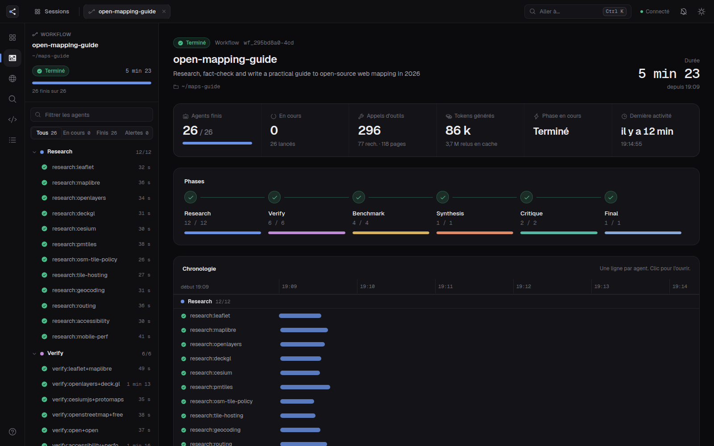

> Not affiliated with Anthropic. "Claude" and "Claude Code" are trademarks of Anthropic.

---

## Contents

- [Features](#features)
- [Quick start](#quick-start)
- [Usage](#usage)
- [Keyboard shortcuts](#keyboard-shortcuts)
- [Configuration](#configuration)
- [How it works](#how-it-works)
- [Development](#development)
- [Limitations](#limitations)
- [Privacy and security](#privacy-and-security)
- [License](#license)

---

## Features

### All your sessions in one place

The **Sessions** page lists every Claude Code session on the machine that launched agents
(through the `Agent` tool) or workflows, grouped by day, with the session title, its
working directory, the first prompt, and how many agents finished. Sessions that are
running right now pulse green. Open several at once: each one gets its own tab and keeps
its own state.

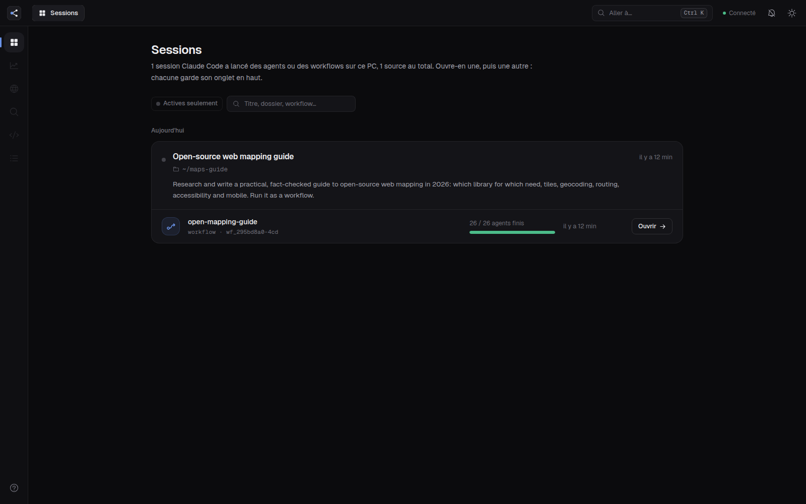

### Overview of a run

For a workflow or a session's agents:

- **Key figures**: agents finished out of expected, agents running, tool calls, web
  searches, pages read, tokens generated, current phase, last activity.
- **Phases**: a pipeline of the workflow's phases (read from the workflow script) with
  progress for each one.
- **Timeline**: one bar per agent over time, grouped by phase, with a "now" line. Hover
  for details, click to open the agent.
- **Live activity**: the latest tool calls across all agents, as they happen.
- **Breakdowns**: tools used, most-read websites, tokens generated per agent.

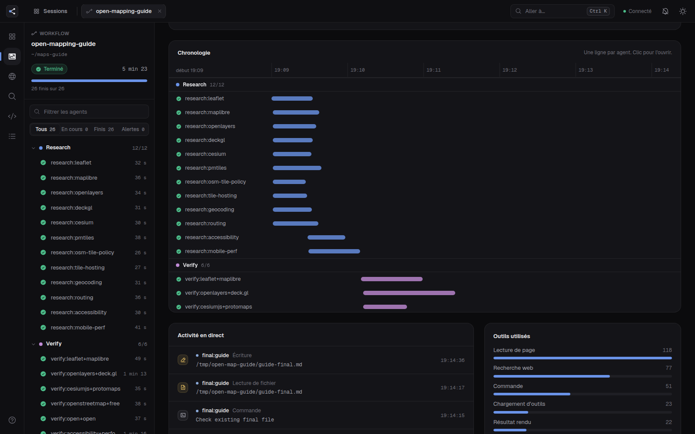

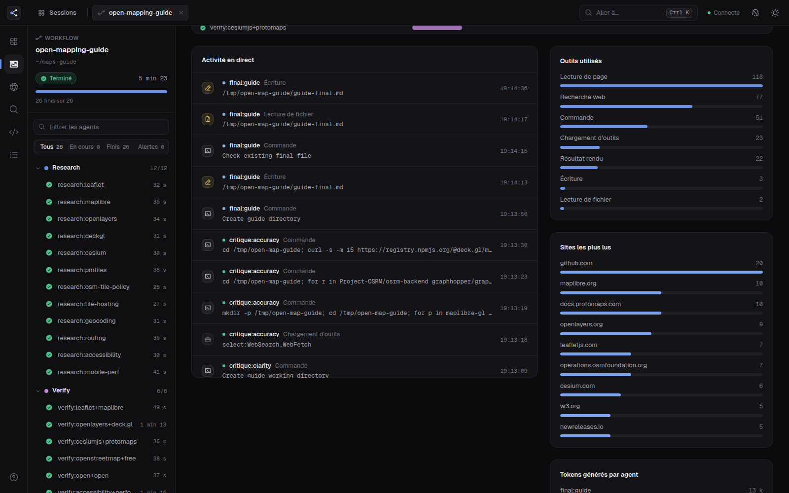

### Inside an agent

Click any agent to open it. The header shows its status, phase, model, effort, duration,
tool calls, errors, thinking time, tokens and API requests. Then six tabs:

| Tab | What you see |
|---|---|
| **Timeline** (*Fil*) | Everything the agent did, in order: its messages, thinking steps (with their duration) and every tool call as a card. Open a card to see what was sent and what came back. |
| **Prompt** | The exact task the agent received, rendered as Markdown, plus the user request relayed by the workflow harness. |
| **Tools** | Every web search, page, file, command and MCP call, grouped by tool, with status and duration. Click a row to jump to it in the timeline. |
| **Result** | The value the agent returned: a JSON tree (arrays of objects can switch to a table) or Markdown text. Copy or download it. |
| **System** | The agent's system prompt, the tools it was given, and the context injected into it (CLAUDE.md, reminders). |
| **Raw** | The parsed events as JSON, downloadable. |

You can also copy the prompt or **export the whole agent as Markdown**.

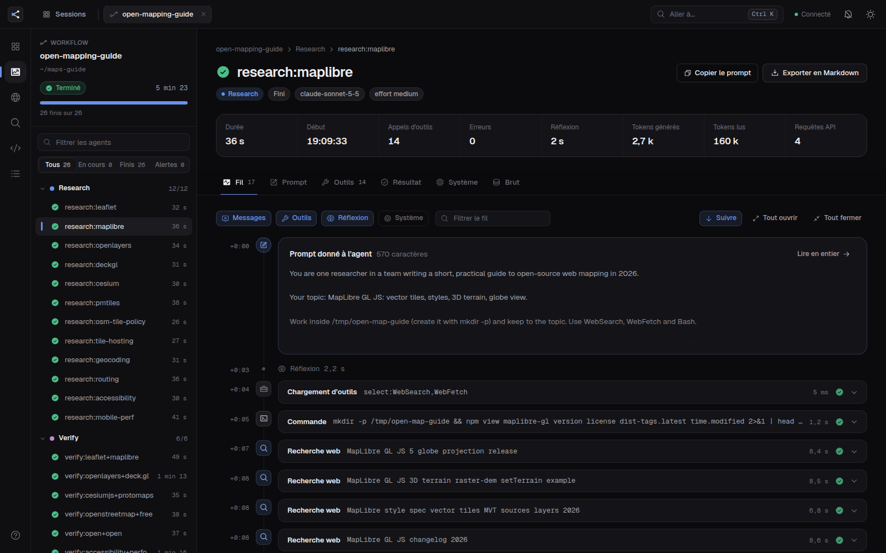

Tool cards show each tool in the most useful way: the command for `Bash`, the URL and the
question asked for `WebFetch`, the query for `WebSearch`, a before/after view for `Edit`,
images the agent looked at, hooks that rewrote a command, and long results that load in
full on demand.

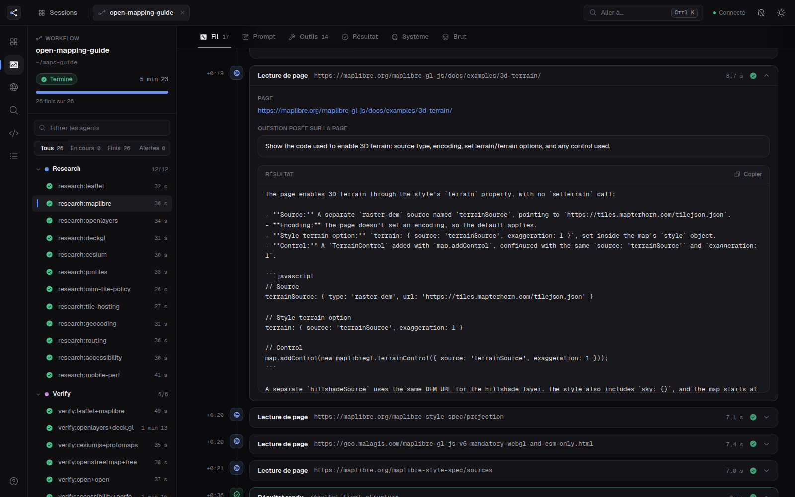

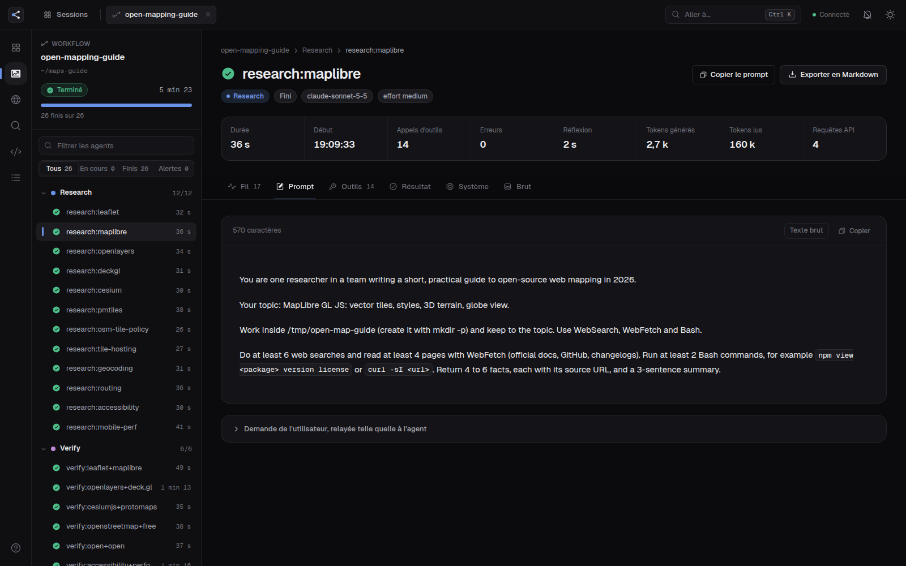

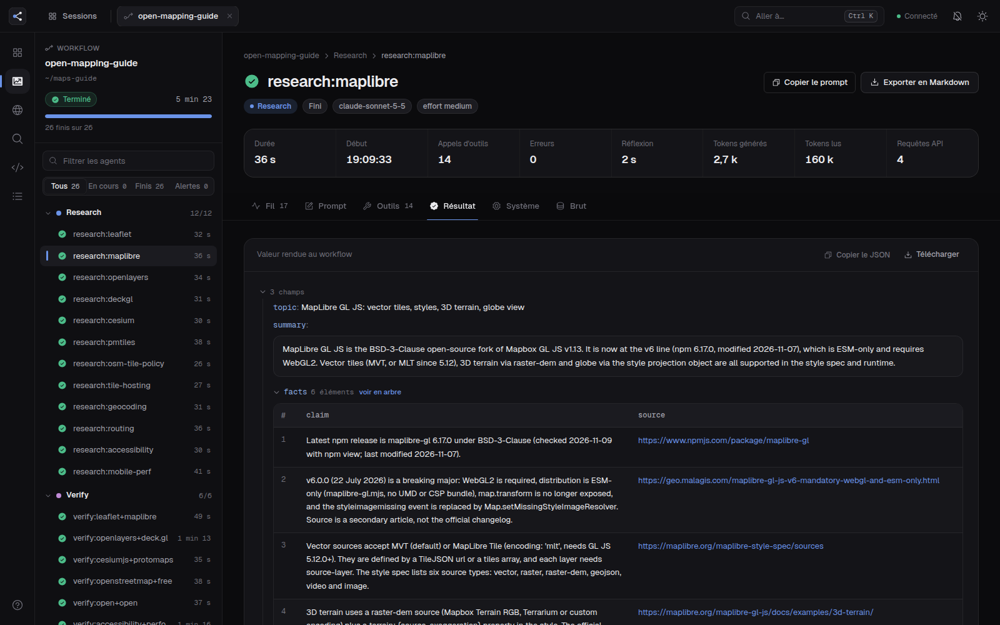

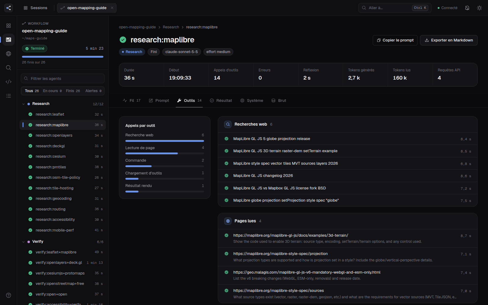

### Sources and search

- **Sources** gathers everything all the agents read, searched, opened or ran: pages,
  web searches, files, commands, written files, MCP calls. Each item is counted, and the
  agents that used it are one click away.
- **Search** finds a word anywhere: prompts, answers, tool inputs and tool results, for
  every agent of the open session.

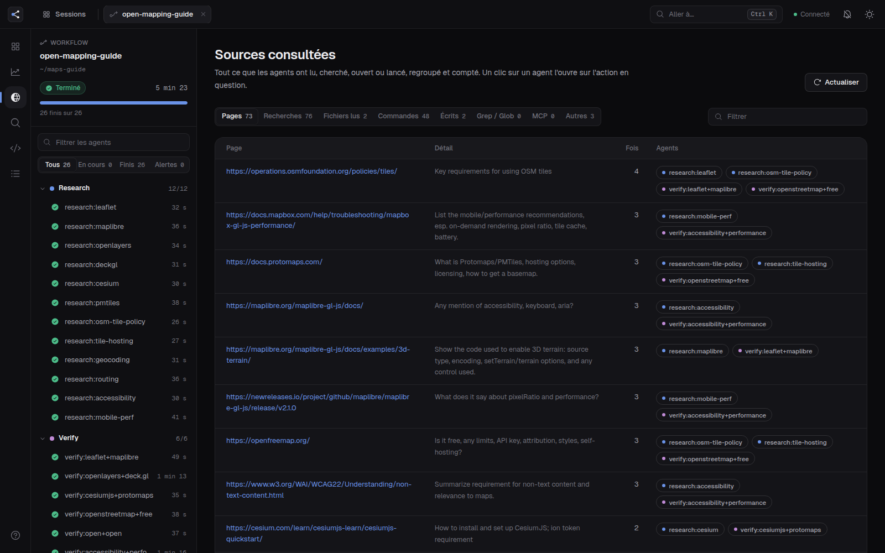

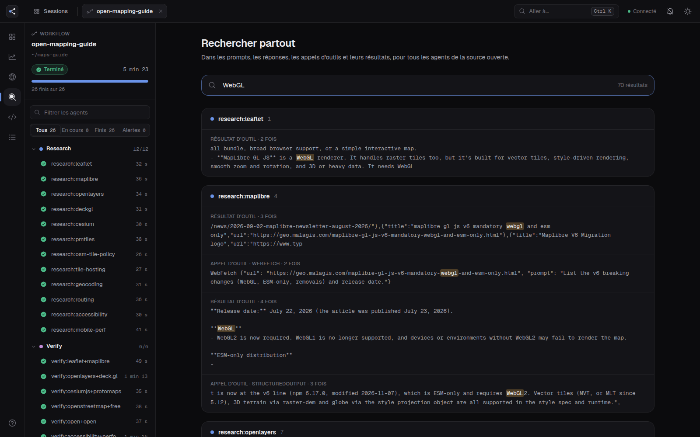

### And also

- **Command palette** (`Ctrl+K`): jump to any agent, session or view.
- **Notifications**: a toast when an agent finishes, fails or stalls, when a phase
  completes or when the workflow ends, plus optional browser notifications.
- **Workflow script and journal**: read the workflow's source code and its raw
  `journal.jsonl`.
- **Dark and light themes.**

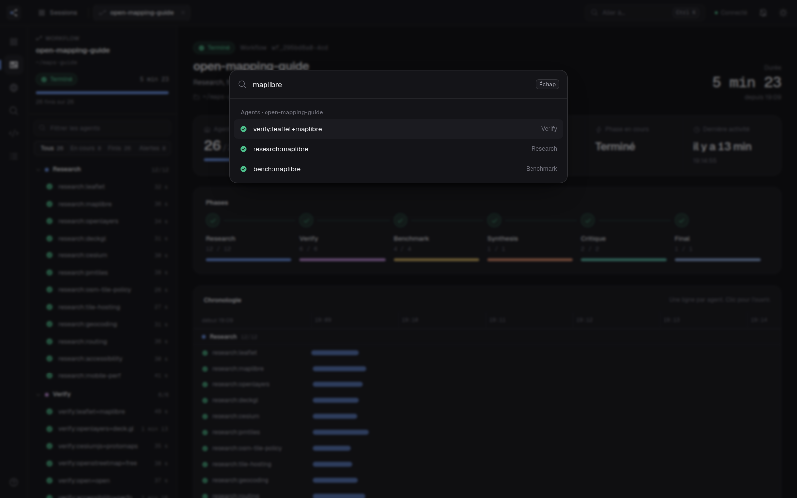

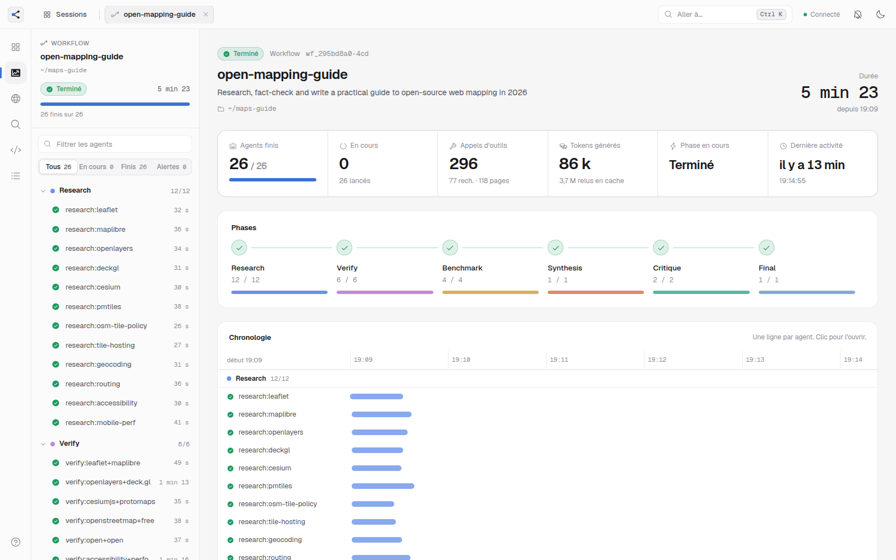

---

## Quick start

Requirements: **Python 3.9+** (standard library only) and **Node.js 18+** to build the
interface once.

```bash
git clone https://github.com/quentin-hoa/agent-lens.git
cd agent-lens/web
npm install
npm run build
cd ..
python3 server.py
```

The server starts in the background, prints its address and opens your browser at
`http://127.0.0.1:8765`. Start a Claude Code session that uses agents or a workflow and it
shows up on the Sessions page within a few seconds.

Optional: add a shell command to start it from anywhere, for example in `~/.bashrc` or
`~/.zshrc`:

```bash
agents() { python3 "$HOME/agent-lens/server.py" "$@"; }
```

Then `agents`, `agents stop`, `agents restart`.

---

## Usage

```text
python3 server.py                 start in the background and open the browser
python3 server.py stop            stop it
python3 server.py restart         restart it
python3 server.py --foreground    stay in the terminal (Ctrl+C to stop)
python3 server.py --port 9000     use another port (the next free one is used if taken)
python3 server.py --no-open       do not open the browser
```

Running it again while it is already running just opens a new browser tab. The process id
is kept in `.agents-panel.pid` and the log in `agents-panel.log`, next to `server.py`.

---

## Keyboard shortcuts

| Keys | Action |
|---|---|
| `Ctrl` `K` | Go to an agent, a session or a view |
| `G` | Sessions |
| `O` | Overview of the open session |
| `S` | Sources |
| `/` | Search |
| `J` / `K` | Next / previous agent |
| `1` … `6` | Agent tabs |
| `A` | Follow the agent live (auto-scroll) |
| `E` | Open every card of the timeline |
| `?` | Help |

---

## Configuration

**Expected agent counts.** Workflows do not declare how many agents they will start, so by
default progress is shown against the agents started so far. To show "23 / 91–103" instead,
create `expected.json` next to `server.py` (see `expected.example.json`):

```json
{
  "my-workflow-name": {
    "Research": [10, 12],
    "Verify": [10, 12],
    "Synthesis": [1, 1]
  }
}
```

Keys are the workflow `meta.name` and its phase titles; values are `[min, max]`.

**Thresholds.** A few constants at the top of `server.py`: `STALE_AFTER` (an agent is
flagged inactive after 15 minutes without writing anything), `STALLED_AFTER` (a workflow
is flagged stalled after 20 minutes), `LIVE_WINDOW` (a session counts as active if a file
changed in the last 150 seconds), and the default port.

---

## How it works

Claude Code writes one JSON Lines transcript per sub-agent:

```text
~/.claude/projects/<project>/<session>.jsonl                      main conversation (title, cwd)
~/.claude/projects/<project>/<session>/subagents/agent-<id>.jsonl agents started with the Agent tool
~/.claude/projects/<project>/<session>/subagents/agent-<id>.meta.json
~/.claude/projects/<project>/<session>/subagents/workflows/wf_<id>/journal.jsonl
~/.claude/projects/<project>/<session>/subagents/workflows/wf_<id>/agent-<id>.jsonl
~/.claude/projects/<project>/<session>/workflows/scripts/<name>-wf_<id>.js
```

`server.py` (Python standard library, a single file):

- discovers sessions and workflows every few seconds;
- reads each transcript **incrementally** (only the bytes appended since the last read),
  and turns it into events: prompt, messages, thinking, tool calls, tool results, hooks;
- reads the workflow journal (agent started, agent result) and the workflow script
  (`meta.name`, `meta.description`, `meta.phases`);
- serves a small JSON API and the built interface on `127.0.0.1`.

The interface (`web/`, React 19, Vite, Tailwind CSS 4, Framer Motion, Phosphor icons,
cmdk, sonner) polls the API: the session state every 2 seconds (the server answers
"unchanged" when nothing moved), the open agent every 1.5 seconds (new events only), and
the session list every 5 seconds.

<details>
<summary>API endpoints</summary>

| Endpoint | Returns |
|---|---|
| `GET /api/ping` | `{app, pid}` |
| `GET /api/sessions` | every session with agents or workflows, and its sources |
| `GET /api/state?wf=<source>&v=<version>` | totals, phases, agents, live feed of a source (`wf_…` or `s_<session>`) |
| `GET /api/agent?wf=&id=&since=&res=` | an agent's header and its events after index `since` |
| `GET /api/full?wf=&id=&tu=` | the full text of a long tool result |
| `GET /api/img?wf=&id=&n=` | an image the agent looked at |
| `GET /api/system?wf=&id=` | system prompt, tool list and injected context |
| `GET /api/sources?wf=` | pages, searches, files, commands… across all agents |
| `GET /api/search?wf=&q=` | full-text search across all agents |
| `GET /api/script?wf=` | the workflow script |
| `GET /api/journal?wf=` | the raw workflow journal |

</details>

---

## Development

```bash
python3 server.py --foreground     # API on 127.0.0.1:8765
cd web
npm run dev                        # Vite on http://localhost:5173, /api proxied to 8765
npm run typecheck
npm run build                      # writes web/dist, served by server.py
```

---

## Limitations

- **The interface is in French** for now. Translations are welcome.
- Claude Code does not keep the **content of the agents' thinking**, only its duration,
  so the timeline shows a thinking step without its text.
- The transcript format is **internal to Claude Code and undocumented**: it was read from
  Claude Code 2.1 transcripts and may change. Unknown lines are shown as "system" events
  rather than breaking the page.
- Tested on **Linux** only. Background mode uses `fork`; on Windows, use `--foreground`.

---

## Privacy and security

- Read-only: nothing is written to `~/.claude`.
- The server listens on `127.0.0.1` only and makes no outbound requests. The interface
  loads nothing from the internet (fonts and icons are bundled).
- Transcripts can contain anything your agents saw, including secrets they read. Do not
  expose the port to a network.

---

## License

[MIT](LICENSE) © 2026 Quentin Hoarau
